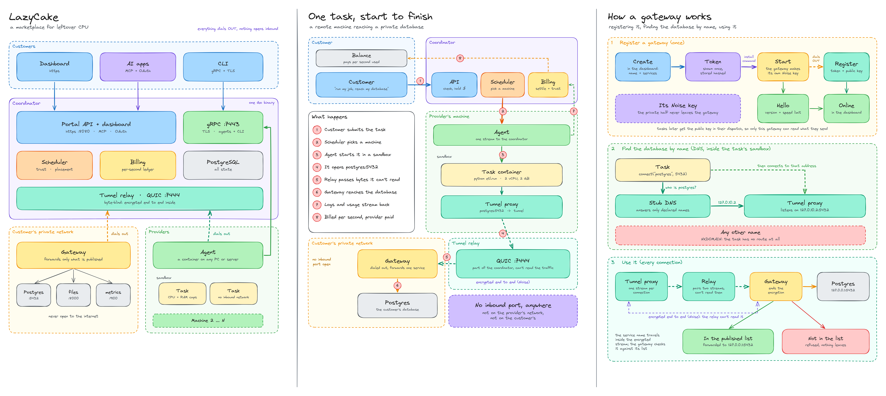
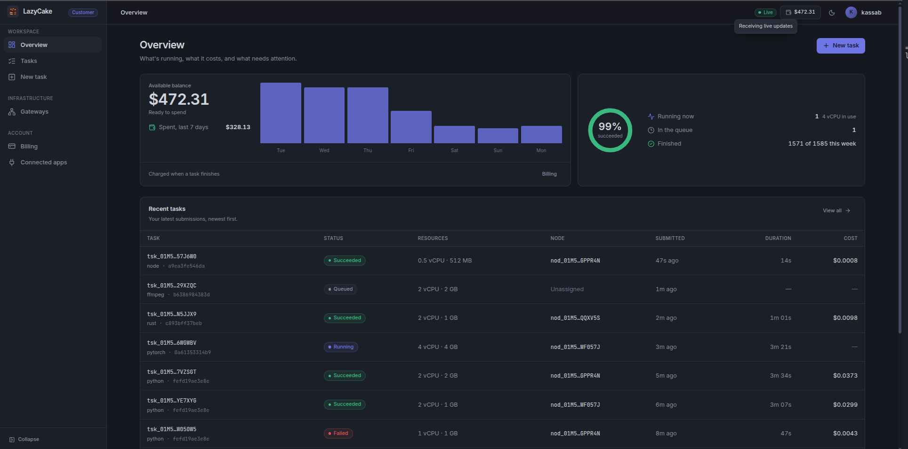
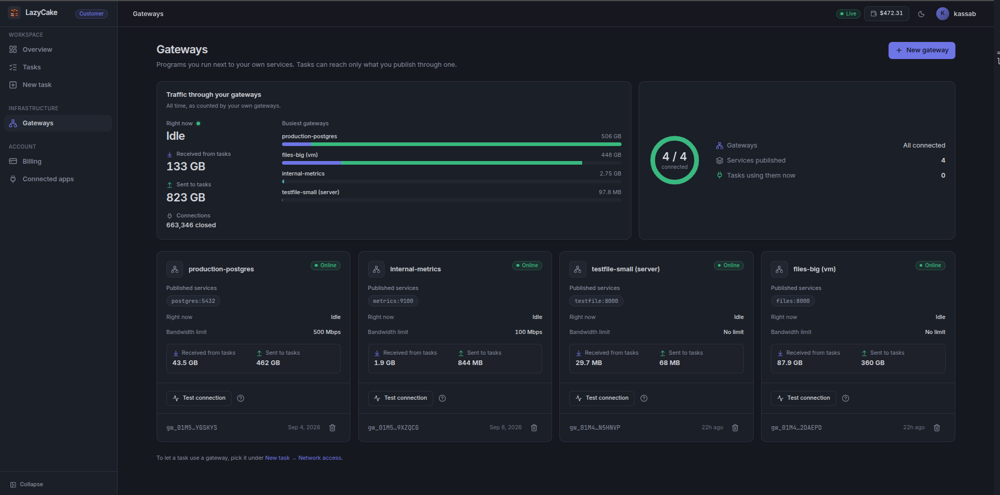
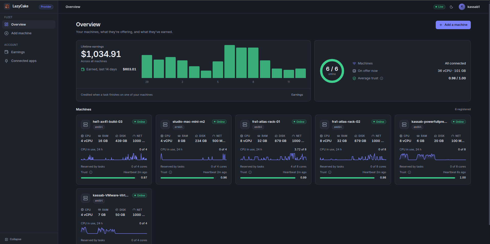
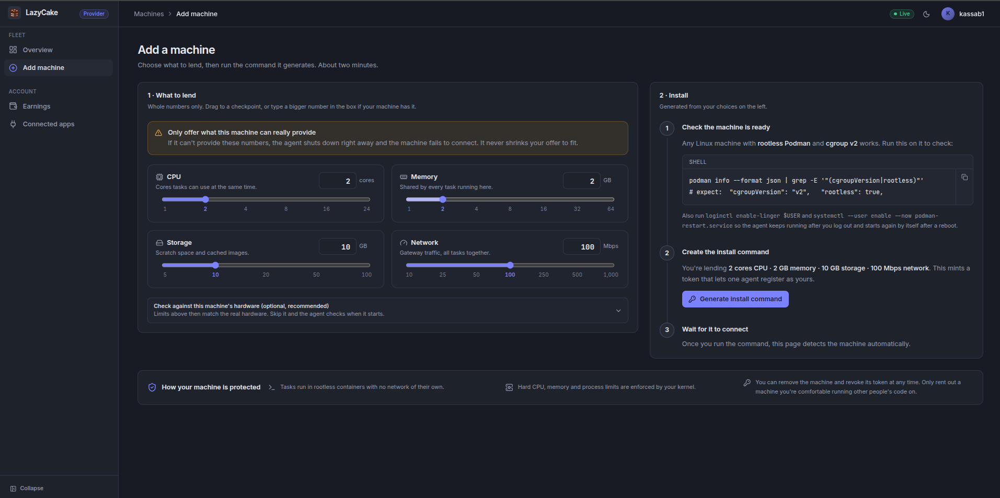

# LazyCake: a marketplace for leftover CPU

Providers lend the spare capacity of their machines; customers submit container tasks; a coordinator schedules them, meters the real usage and bills it per second. Machines and customers only connect *out*, so nothing is opened inbound.

*Click the diagram to zoom. Source: [`docs/diagrams`](docs/diagrams).*

<table>
  <tr>
    <td width="50%"></td>
    <td width="50%"></td>
  </tr>
  <tr>
    <td width="50%"></td>
    <td width="50%"></td>
  </tr>
</table>

*Top: customer overview and gateways. Bottom: provider overview and add a machine.*

## Why the name

A lazy cake is the no-bake chocolate biscuit cake made from leftover pieces you already have: no oven, no effort, and better than its parts. LazyCake does the same with computers: lots of small, idle ("lazy") machines combined into something useful with almost no effort.

## Main features

- **Run any container** on spare machines, with real CPU, memory and disk limits.
- **Pay per second** for what is actually used; providers are credited for it.
- **Private services** reachable through gateways over an encrypted tunnel.
- **Fair scheduling**: trust scores, canary tasks and a three-way byte check against cheating.
- **Dashboard, CLI and AI apps** (through MCP) for customers and providers.
- **TLS everywhere**, with a self-renewing Let's Encrypt certificate.

## More

[Quickstart, public images, screenshots and design decisions](docs/DEVELOPMENT.md) · [Architecture index](.claude/README.md) · [Changelog](CHANGELOG.md)
